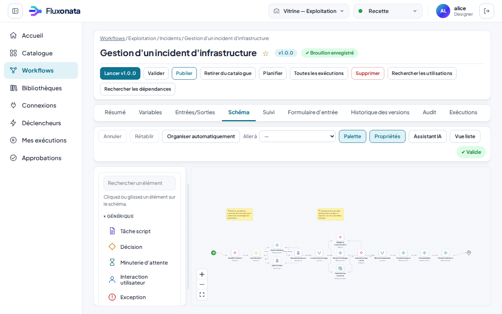
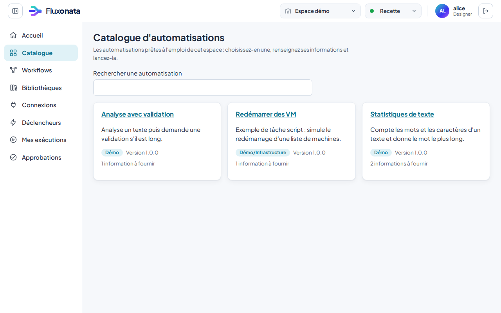
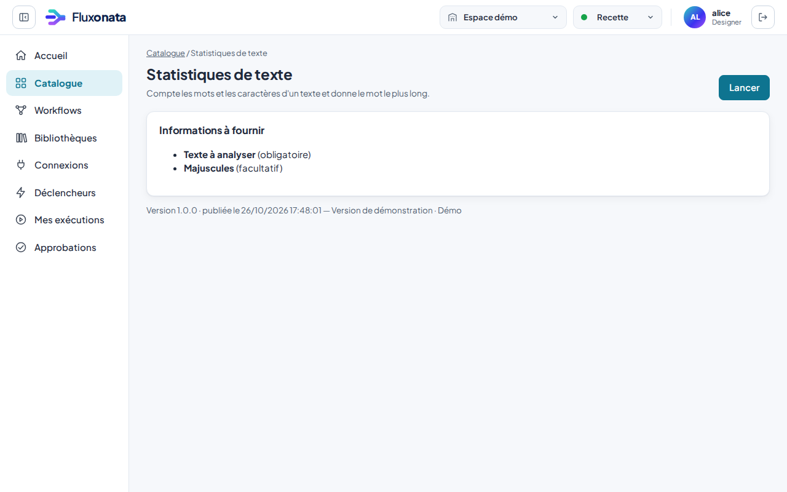
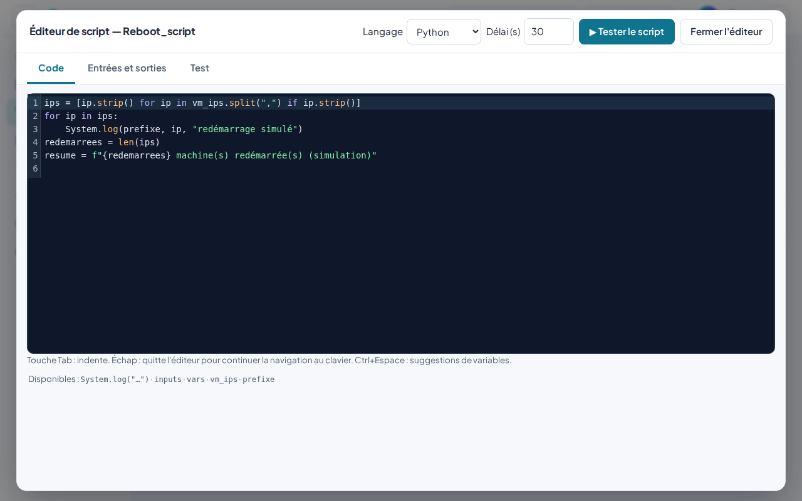
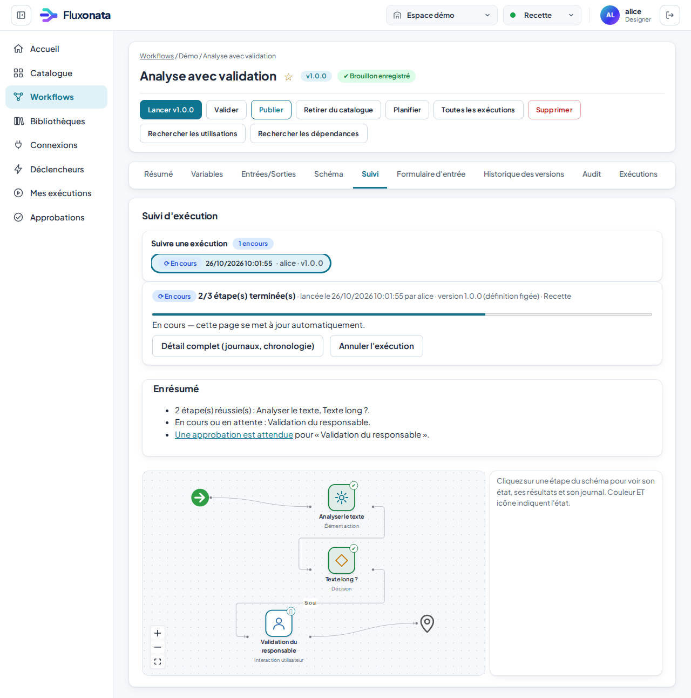
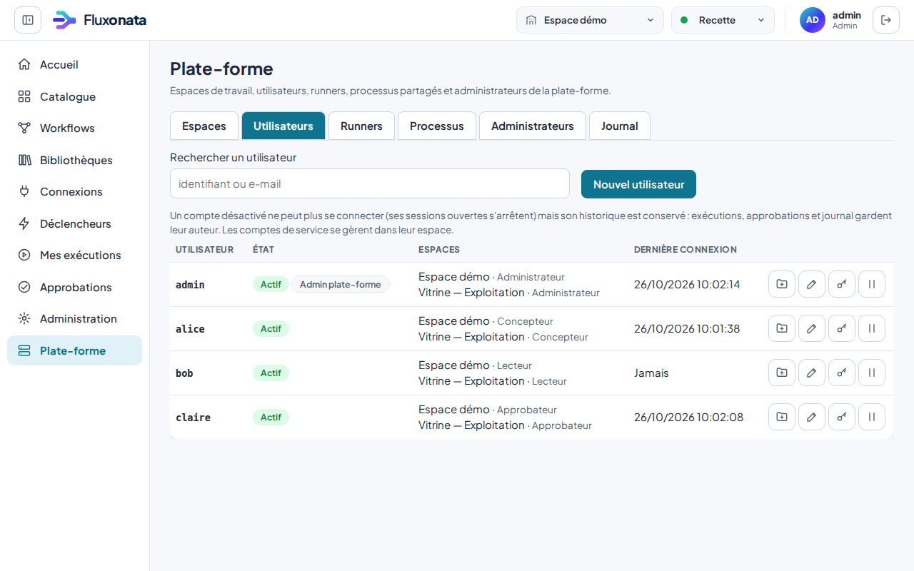
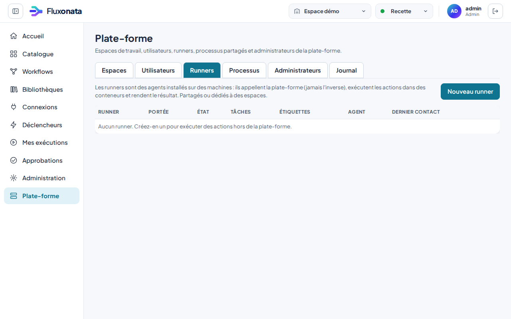
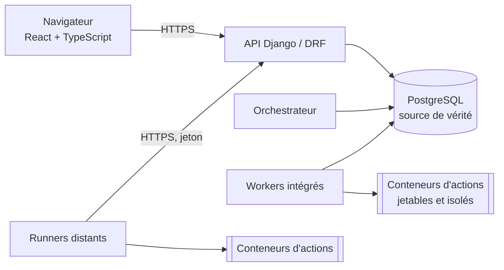

<p align="center">
  
</p>

<p align="center">
  <strong>Plateforme d'orchestration open source et auto-hébergeable</strong><br>
  Concevez des workflows graphiques, exécutez vos actions en toute sécurité, gouvernez qui peut faire quoi.
</p>

<p align="center">
  <a href="LICENSE"></a>
  
  
  
  
  
</p>

> *Fluxonata is a self-hosted, Apache-2.0 workflow orchestration platform: a visual workflow editor, sandboxed action execution (containers), remote runners, approvals, RBAC across workspaces, an audit trail and optional, governed AI assistance. The interface is in French.*

<p align="center">
  
</p>

## Pourquoi Fluxonata

Fluxonata automatise des procédures d'exploitation et de métier **sans enfermer l'équipe dans un outil opaque** : tout est versionné, relisible, auditable, et reste sur votre infrastructure.

- **Éditeur graphique de workflows** : conditions, branches parallèles, jonctions, boucles « pour chaque », workflows imbriqués, attentes, interactions et approbations humaines, gestion d'erreurs et compensations. Une vue liste, entièrement utilisable au clavier, est équivalente au canevas.
- **Actions et tâches script** : écrivez du Python, JavaScript/TypeScript, shell ou PowerShell. Chaque action s'exécute dans un **conteneur jetable** (utilisateur non privilégié, système de fichiers en lecture seule, ressources limitées, réseau coupé sauf autorisation explicite).
- **Catalogue d'automatisations** : les workflows terminés qu'un espace choisit de proposer, lançables par des personnes non techniques depuis un formulaire généré.
- **Runners distants** : déployez des agents sur vos machines, comme des runners de CI, **partagés** ou **dédiés à des espaces**. Le runner appelle la plateforme (aucun port à ouvrir), les secrets ne lui sont remis que tâche par tâche.
- **Multi-espaces et gouvernance** : espaces de travail avec environnements (développement, recette, production), rôles (responsable, concepteur, opérateur, approbateur, lecteur), politiques versionnées, promotion vers la production avec revue, approbations.
- **Secrets et connexions** : coffre chiffré au repos, injection au moment de l'exécution, masquage dans les journaux, sorties réseau filtrées contre les attaques SSRF.
- **Déclencheurs** : planifications avec fuseaux horaires, webhooks signés, API REST documentée (OpenAPI), jetons de service limités en droits.
- **Assistance IA facultative et encadrée** : génération de brouillons de workflows, **assistant de conversation dans l'éditeur** (« ajoute une décision après l'analyse »), skills IA versionnés, étapes IA dans les workflows. Désactivée par défaut ; mode *local strict* (aucune donnée ne quitte l'infrastructure, ex. un modèle local compatible OpenAI) ; le résultat est toujours un **brouillon à relire**, le code généré doit être relu et confirmé avant publication.
- **Fiabilité** : exécution durable reprenant après panne (baux, jetons de barrière), livraison « au moins une fois », journal d'audit, sauvegarde/restauration testées, métriques.
- **Accessibilité** : interface conçue pour le niveau WCAG 2.2 AA (contrôles automatisés axe-core dans la suite de tests).

## Aperçu

| | |
|---|---|
|  |  |
| **Catalogue d'automatisations** : des workflows prêts à l'emploi | **Fiche** : informations à fournir, version, lancement |
|  |  |
| **Tâche script** : éditeur de code et test isolé | **Suivi d'exécution** et approbation humaine |
|  |  |
| **Utilisateurs** : comptes, espaces et rôles | **Runners** : agents partagés ou dédiés à des espaces |

D'autres écrans (connexions, déclencheurs, skills IA, approbation sur mobile…) sont présentés dans le [guide d'utilisation](docs/USER_GUIDE.md).

## Démarrage rapide

Prérequis : Linux ou WSL2, Docker, Python 3.12+, Node 22+, Git.

```bash
git clone https://github.com/xanathoxic/fluxonata.git
cd fluxonata
scripts/dev-up.sh      # PostgreSQL, migrations, données fictives, API, orchestrateur, worker, interface
scripts/smoke.sh       # vérification de bout en bout
```

Ouvrez <http://127.0.0.1:5173> et connectez-vous avec un compte de démonstration (mot de passe `demo-fluxonata`, **développement uniquement**) :

| Compte | Rôle |
|---|---|
| `alice` | concepteur |
| `bob` | lecteur |
| `claire` | approbatrice |
| `admin` | administrateur (de l'espace et de la plateforme) |

Pour arrêter : `scripts/dev-down.sh`. Puis suivez le [premier workflow en 5 minutes](docs/FIRST_WORKFLOW.md).
Pour essayer l'automatisation et l'assistant IA sur des scénarios réalistes sans toucher à la production, voir les [tests d'automatisation encadrés](examples/tests-automatisation/README.md).

Pour un déploiement sur un hôte (Docker Compose, TLS, sauvegardes, runners), voir le [guide d'installation](docs/INSTALL.md).

## Documentation

| Sujet | Document |
|---|---|
| Installer (développement, production, mises à jour, sauvegardes) | [docs/INSTALL.md](docs/INSTALL.md) |
| Utiliser l'application, pas à pas | [docs/USER_GUIDE.md](docs/USER_GUIDE.md) · [docs/FIRST_WORKFLOW.md](docs/FIRST_WORKFLOW.md) |
| Administrer : rôles, politiques, utilisateurs, SSO, IA | [docs/ADMIN.md](docs/ADMIN.md) |
| Déployer des runners distants | [docs/RUNNERS.md](docs/RUNNERS.md) · [runner/README.md](runner/README.md) |
| Écrire une action | [docs/ACTION_SDK.md](docs/ACTION_SDK.md) |
| API REST | [docs/API.md](docs/API.md) · [docs/openapi.json](docs/openapi.json) |
| Sécurité et signalement de vulnérabilités | [SECURITY.md](SECURITY.md) |
| Contribuer | [CONTRIBUTING.md](CONTRIBUTING.md) |

## Architecture



Monolithe modulaire Django/DRF (`backend/` : `tenancy`, `catalog`, `workflows`, `runs`, `triggers`, `vault`, `bundles`, `ai`, `audit`, `core`),
PostgreSQL comme unique source de vérité, **processus séparés** : API, orchestrateur, workers. Le code d'une action ne s'exécute jamais dans le processus web.
Interface React/TypeScript strict (`frontend/`), protocole d'actions indépendant du langage (`workers/`), agent runner autonome (`runner/`).

## Sécurité et limites (en toute transparence)

- Les actions tournent dans des conteneurs non privilégiés, sans réseau, en lecture seule : adapté à du code **de confiance ou peu fiable**, **pas** à du code hostile en multi-tenant (le noyau est partagé ; voir `ORCH_HARDENED` et les runtimes de type gVisor dans le guide d'installation).
- Livraison des tâches **au moins une fois** : aucune promesse « exactement une fois » pour les effets externes (les actions à effet non idempotent ne sont jamais rejouées automatiquement).
- Le journal d'audit est *append-only* au niveau applicatif, pas contre un administrateur de base de données.
- Un runner distant compromis expose le code et les secrets des tâches qu'il reçoit (pas ceux des autres espaces) : dédiez des runners aux espaces sensibles.
- **Version 0.1** : la plateforme n'a pas fait l'objet d'un audit de sécurité externe ni d'une étude utilisateur ; l'authentification SSO (OIDC) a été testée contre un fournisseur simulé, pas contre un fournisseur réel.

## Vérifier le projet

```bash
scripts/ci.sh                  # format, lint, types, migrations, tests, build, audits, secrets, SBOM, E2E + accessibilité
scripts/resilience.sh          # arrêt brutal des services, redémarrage de PostgreSQL
scripts/restore-test.sh        # sauvegarde → restauration → vérification
```

## Contribuer

Les contributions sont les bienvenues : lisez [CONTRIBUTING.md](CONTRIBUTING.md). Pour une faille de sécurité, n'ouvrez pas de ticket public : voir [SECURITY.md](SECURITY.md).

## Licence

[Apache-2.0](LICENSE) — voir aussi [NOTICE](NOTICE). Aucune fonctionnalité « enterprise », aucun compteur, aucune clé d'activation.
