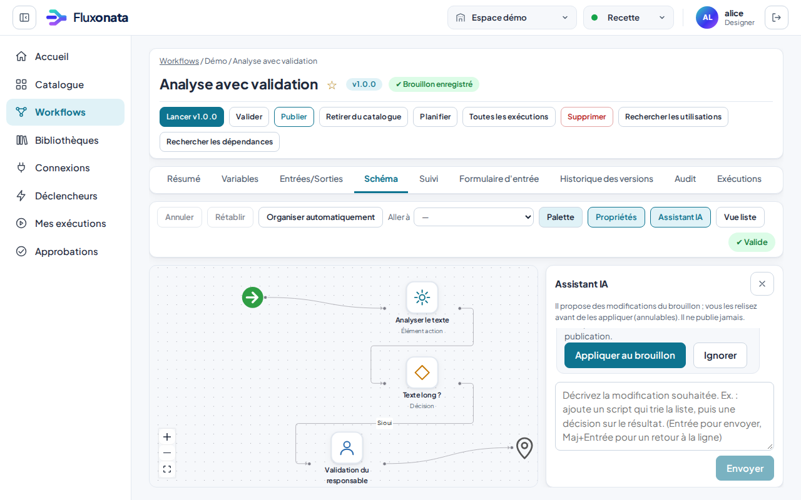

# Guide utilisateur illustré

Toutes les captures proviennent du jeu de **données fictives** de démonstration (`scripts/screenshots.sh`) ; aucun secret ni donnée réelle.
Trois profils utilisent la même application : **utilisateur métier**, **concepteur**, **administrateur/développeur**. La complexité avancée n'apparaît qu'à la demande.

## 1. Se connecter

Identifiant et mot de passe (ou « SSO de l'organisation » si votre administrateur l'a activé). Un message d'erreur distingue : identifiants incorrects, trop de tentatives, problème technique.

## 2. Accueil
> **Menu de gauche repliable** : le bouton à gauche du logo replie le menu en une colonne d'icônes (le contenu gagne la place) et le déplie. Chaque icône garde son nom (info-bulle et lecteurs d'écran) et les sous-menus de « Bibliothèques » restent atteignables ; le choix est mémorisé. Sur téléphone, le bouton « Menu » reste utilisé.

L'accueil s'adapte à votre rôle : **À traiter** (approbations en attente, décisions à prendre), **Démarrer en 5 minutes** (guide intégré), **Exécutions récentes**.
En haut de chaque écran : l'**espace** et l'**environnement** (Recette / Production) sont toujours visibles, en toutes lettres ; la production affiche en plus un bandeau d'avertissement.

## 3. Trouver une automatisation (utilisateur métier)

Le catalogue ne contient que des **automatisations terminées** : des workflows qu'une personne autorisée à publier a choisi de proposer (bouton **« Publier au catalogue »** dans la barre d'actions d'un workflow qui a une version publiée ; **« Retirer du catalogue »** pour l'enlever). Les actions, qui ne sont que des briques, restent dans Bibliothèques → Actions (où un concepteur peut en lancer une pour un essai). Recherche par nom, description ou dossier ; la fiche indique les informations à fournir, la version et sa date, puis **Lancer**. Un workflow déprécié disparaît du catalogue.

## 4. La lancer et lire le résultat

Le formulaire est généré depuis le contrat de l'automatisation : champs obligatoires, aide, erreurs liées au champ concerné, bouton d'exemple.

Le statut est écrit en toutes lettres (jamais seulement une couleur). La page se met à jour seule ; les journaux techniques restent repliés.

> **Panneaux latéraux** : les formulaires de création (connexion, planification, webhook, action, membre, jeton) et l'examen d'une demande s'ouvrent dans un panneau par-dessus la page. Échap ou le bouton « Fermer » le referme et le focus revient où vous étiez ; la page derrière est inactive tant qu'il est ouvert.

## 4 bis. Générer un brouillon de workflow avec l'IA (facultatif)
Si l'assistant IA est activé pour l'espace (Administration → Assistant IA), **Workflows → Générer avec l'IA** ouvre un panneau : décrivez en français ce que le workflow doit faire. L'assistant propose un **brouillon** en privilégiant les actions du catalogue de l'espace, des **tâches script** quand aucune action ne convient, et tous les autres types d'étapes (décisions, approbations, attentes, exceptions, boucles, sous-workflows, étapes IA) quand la demande l'exige ; il n'appelle que des workflows, skills et fournisseurs qui existent dans l'espace.
- Le résultat est **toujours un brouillon** : il n'est jamais publié automatiquement. Le compte rendu indique le nombre d'étapes proposées et les problèmes détectés par la validation.
- Un **script écrit par l'IA** est marqué « non relu » et **bloque la publication** tant que vous ne l'avez pas relu, testé (onglet Test) et confirmé (**J'ai relu ce code**) dans l'éditeur de script.
- En mode *local strict*, aucune donnée ne quitte l'infrastructure (modèle local compatible OpenAI).

## 4 ter. Modifier un workflow en discutant avec l'assistant IA (facultatif)
Quand l'assistant IA est activé, le bouton **Assistant IA** de la barre d'outils du schéma ouvre une conversation sous le schéma. Demandez en français une modification du workflow ouvert : « ajoute une décision après l'analyse », « ajoute un script qui calcule la moyenne », « que fait ce workflow ? ».

- L'assistant **propose** : la réponse liste les changements (étapes ajoutées, supprimées, modifiées, liaisons, entrées) et les problèmes de validation à prévoir. **Rien n'est appliqué sans votre accord** : **Appliquer au brouillon** ou **Ignorer**.
- Appliqué, le changement entre dans l'historique du brouillon : **Annuler** (dans la conversation ou dans la barre d'outils) le retire. Les nouvelles étapes sont placées à droite de leur prédécesseur ; les étapes existantes ne bougent pas.
- Il dispose de **tous les types d'étapes** : actions du catalogue de l'espace, décisions, jonctions, scripts, attentes, approbations, exceptions, sous-workflows, boucles « pour chaque » et étapes IA (avec un skill de la bibliothèque ou une tâche libre). Il ne choisit que parmi les workflows publiés, skills et fournisseurs IA **qui existent dans l'espace** : un identifiant inventé est signalé par la validation. Les boucles sont toujours bornées (1 à 100 itérations, 10 en parallèle au plus). Il peut ajouter des **variables**, changer leur valeur ou en supprimer, et ajouter, reformuler ou supprimer des **notes** (annotations visuelles, jamais exécutées).
- **Comment il travaille** : pour créer un workflow, il écrit un **plan** (une suite d'étapes, des blocs « si… sinon », « en parallèle » et « en cas d'erreur », comme on raconte le déroulé) et **la plateforme construit elle-même le schéma** : liaisons, jonctions, sorties oui/non, une seule étape de départ, un refus d'approbation relié à la sortie d'erreur. Ces erreurs de câblage ne peuvent donc pas se produire. Pour **modifier** un workflow, il ne réécrit pas tout : il propose des **opérations précises** (ajouter une étape après telle autre, changer une condition, relier, supprimer une note…) appliquées par la plateforme ; le résumé « Modifications proposées » est la liste de ce qui a réellement changé, et une opération impossible est dite en clair (« Non appliqué : … »).
- **Le plan, avant de générer** : « Générer avec l'IA » commence par **un plan envisagé**, pas par le brouillon. Décrivez ce que vous voulez avec vos mots (deux lignes suffisent) : l'assistant répond par un plan en mots simples, que vous **validez, modifiez ou refusez** avant que quoi que ce soit ne soit généré. Le plan contient le nom du workflow, **les informations demandées au lancement** (nom, type, à quoi ça sert), **ce que fera le workflow dans l'ordre** (y compris les décisions, les approbations et ce qui se passe en cas de refus, les notifications, les échecs), ce qui existe déjà dans votre espace et sera **réutilisé** (actions, workflows, skills : il n'en invente pas), **ce qu'il a supposé** parce que vous ne l'aviez pas dit, et **au plus quatre questions** avec une réponse proposée. Vous pouvez **éditer directement** chaque zone (une ligne par information, par étape, par hypothèse), **changer les réponses proposées**, ou écrire une **consigne libre** (« ajoute une notification à la fin », « supprime l'attente ») : « Réviser le plan avec cette consigne » rédige un nouveau plan à partir du vôtre. **Refuser ce plan** revient à votre demande, qui est conservée. **Valider et générer** lance la génération avec le plan tel que vous l'avez corrigé : les noms et les textes entre « » sont repris tels quels et servent de référence aux contrôles. « Générer sans plan » reste disponible pour une demande déjà très précise. Le plan coûte un appel court au modèle (quelques secondes) ; sur nos quatre demandes en langage courant, les générations passées par le plan ont respecté 19 critères de structure sur 20, contre 16 sur 20 sans plan (un seul passage chacun, modèle local : à prendre comme une indication).
- **Essai à blanc** : avant de vous présenter un brouillon, l'assistant l'**exécute à blanc**. Les **scripts et les décisions tournent pour de vrai**, dans le même bac à sable que les exécutions normales (sans réseau, sans fichiers, sans secrets, avec limites de temps et de mémoire), sur des **jeux d'essai** : des valeurs réalistes proposées par le modèle (avec les résultats que votre demande permet d'attendre), un jeu « typique » et un jeu « limite » (liste vide, zéro, faux) déduits des entrées. Ce qui agirait sur l'extérieur ou attendrait une personne est **simulé** d'après son contrat : actions, appels de workflows, étapes IA, approbations (accordées, puis refusées) et attentes ; chaque étape qui a une sortie d'erreur est aussi essayée en échec. L'essai trouve ce que l'analyse statique ne voit pas : un script qui plante sur une valeur réaliste (avec la ligne), une sortie du mauvais type, une décision qui lit un champ inexistant, une étape lue sur un chemin où elle n'a pas tourné, un résultat différent de l'attendu. Les problèmes de la première série d'essais sont corrigés automatiquement (un tour), puis l'essai est refait. Le rapport final indique les scénarios, ce qui a été exercé et ce qu'aucun jeu n'a atteint. **Ce n'est pas une preuve** : seulement que le workflow tient sur ces jeux ; les actions réelles ne sont pas appelées. Un administrateur peut le désactiver (Administration → Assistant IA).
- **Suivi de la génération** : la génération d'un brouillon est une tâche exécutée par le travailleur (jamais par le processus web). La fenêtre affiche une **barre de progression** et un **journal en direct** : contexte, rédaction du plan, construction du schéma, contrôle de cohérence, correction, essai à blanc scénario par scénario, analyse, relecture, enregistrement. Vous pouvez fermer la fenêtre : la génération continue et le brouillon apparaît dans la liste.
- **Consommation** : chaque réponse indique les jetons dépensés et le total du jour par rapport au budget de l'espace (1 000 000 par jour par défaut, modifiable dans Administration → Assistant IA).
- Garde-fous : il ne supprime une note ou une variable que si vous le demandez explicitement (une simple omission n'est jamais une suppression), et **jamais une approbation** (une étape d'approbation qu'il omet est remise), et il n'active jamais l'auto-approbation. Les formulaires d'entrée et les politiques de l'espace ne lui sont pas accessibles.
- **Contrôle automatique** : avant de vous présenter un brouillon ou une proposition, l'assistant la fait contrôler deux fois. D'abord par le validateur de la plateforme (étapes isolées, références hors de portée, scripts qui lisent `steps` directement, noms indéfinis, sorties jamais affectées…) : si le modèle s'est trompé, il reçoit les erreurs et corrige (deux tours au plus). Ensuite par une seconde lecture indépendante qui compare le résultat à votre demande : chaque exigence est notée couverte, partielle ou manquante, les scripts sont relus ligne à ligne, et les écarts sont corrigés (un tour, puis une nouvelle lecture). Le résultat indique « Contrôle automatique : 7/8 exigence(s) couverte(s), 2 problème(s) corrigé(s), 1 remarque(s) restante(s) » ; les remarques non résolues apparaissent comme avertissements « Contrôle IA : … ». Un contrôle sans modèle compare aussi ce que votre demande énonce en toutes lettres (noms d'entrées, sorties et variables, textes entre guillemets pour les titres et messages, durées d'attente, nombre d'itérations et de parallèles, comparaisons « strictement supérieur », workflows à appeler) avec le résultat ; les scripts sont vérifiés (noms indéfinis, sorties jamais affectées, `steps` lu directement), et la lecture d'une étape qui n'est que sur une branche d'une décision est signalée. Une demande peut compter jusqu'à 6000 caractères (au-delà, elle est refusée, jamais tronquée en silence). **C'est une aide, pas une garantie** : un modèle peut se tromper en contrôlant, relisez le résultat et testez les scripts. Si le contrôle ne peut pas s'exécuter, la proposition est rendue avec la mention « Contrôle automatique non effectué ».
- Un **script écrit ou modifié par l'assistant** doit être relu, testé et confirmé (**J'ai relu ce code**) avant toute publication, comme pour un brouillon généré.
- Une proposition devient périmée si vous modifiez le workflow entre-temps : redemandez-la. La conversation est conservée tant que vous restez dans l'application (pas après un rechargement de la page) ; l'assistant ne publie jamais.

## 5. Concevoir un workflow (concepteur)

La liste des workflows est un **arbre de dossiers** (Démo / Infrastructure…) avec recherche et favoris (★). Un workflow s'ouvre sur une page à **onglets** : Informations, Variables, Entrées/Sorties, Conception (le schéma), Suivi, Formulaire d'entrée, Versions, Activité, Exécutions. L'en-tête tient sur une ligne et ne bouge pas d'un onglet à l'autre : titre, ligne d'état (« v1.0.0 publiée · Brouillon enregistré »), actions. Une **barre d'actions** propose : Lancer, Valider, Planifier, Toutes les exécutions, Supprimer, Rechercher les utilisations / dépendances.

L'onglet **Conception** a une palette d'éléments à gauche (Tâche script, Décision, Choix multiple, Attente, Interaction, Exception, Jonction, Pour chaque, Workflow, Étape IA, Note, puis les actions du catalogue), le schéma au centre et, à droite, les **propriétés** de l'élément sélectionné (Général, Entrées/Sorties, Script, Effets…). Double-cliquez ou appuyez sur Entrée sur une étape pour l'ouvrir.

**Choix multiple.** Quand une décision oui/non ne suffit pas (selon l'environnement, la gravité…), l'élément *Choix multiple* porte une liste de **cas**, chacun avec un identifiant et une condition. Les cas sont examinés dans l'ordre : le premier dont la condition est vraie est pris, sinon la sortie « Sinon ». Chaque cas a sa propre sortie, à relier à l'étape qui suit ; l'étape lit le cas retenu par `steps.<id>.output.result`. L'assistant IA sait en générer et en modifier ; l'essai à blanc parcourt chaque cas une fois.

**Attente reprise par appel HTTP.** L'élément *Attente* peut, au lieu d'attendre une durée fixe, attendre qu'un système externe le reprenne (validation hors plateforme, fin d'un traitement distant…). Choisissez « Sur appel HTTP » : à chaque exécution, la page de l'exécution affiche une adresse de reprise (réservée aux personnes qui peuvent lancer le workflow). Un POST JSON sur cette adresse reprend l'exécution, une seule fois ; le corps reçu est lu par `steps.<id>.output.payload.<champ>`. Si rien n'arrive avant le délai maximum, l'exécution reprend avec `steps.<id>.output.resumed = false`.

**Expressions.** Dans une décision, un choix, une boucle ou un `{{ … }}`, vous pouvez calculer (`+ - * / %`, parenthèses ; `+` assemble aussi deux textes) et utiliser les fonctions `len, lower, upper, trim, str, number, round, abs, min, max, sum, join, split, replace, starts_with, ends_with, first, last, keys, unique, sort, default`. Exemple : `round(steps.total.output.montant * 1.2, 2)`. Pas de boucle ni de condition dans une expression : au-delà d'une ligne, utilisez une tâche script.

**Connexions HTTP.** Menu Connexions, cinq types : jeton porteur, clé d'API (dans un en-tête ou un paramètre), identifiant + mot de passe (Basic), **OAuth2 identifiants client** (la plateforme obtient et renouvelle le jeton) et **OAuth2 autorisation par une personne** (bouton « Autoriser » ; déclarez chez le fournisseur l'adresse de retour `…/api/v1/oauth/callback/` affichée à la création, ou fixez `ORCH_PUBLIC_URL`). Les secrets et les jetons sont chiffrés, jamais réaffichés ni renvoyés par l'API.

**Cadence d'une boucle.** Une boucle *Pour chaque* peut limiter sa cadence (« une itération au plus toutes les N secondes ») pour ménager un service externe.

**Répéter tant que.** L'élément *Répéter tant que* appelle un workflow, puis le rappelle tant que la condition reste vraie (au plus N fois, 100 maximum), avec une pause durable facultative entre deux répétitions : idéal pour attendre qu'un traitement externe se termine. Dans la condition, `last` est le résultat de la répétition qui vient de finir et `iteration` le nombre de répétitions faites ; les entrées peuvent lire le résultat précédent par `{{ default(last.champ, 0) }}`. Sorties : `iterations`, `results`, `last`, `stopped` (`condition` ou `max_iterations`).

**Agent IA.** L'élément *Agent IA* confie un objectif à un modèle qui choisit, un outil à la fois, parmi les **actions du catalogue que vous autorisez** (10 au plus), jusqu'à répondre ou atteindre le nombre maximal de tours (1 à 10). Garde-fous que le modèle ne peut pas modifier : liste d'outils fixée, entrées validées par le contrat de chaque action, actions exécutées dans leur conteneur isolé, résultats d'outils traités comme des *données* (jamais comme des instructions), **validation humaine** avant tout outil à effet externe (réglage par défaut). En **mode test** (par défaut) le modèle décide mais les outils sont simulés. Sorties : `answer`, `steps`, `iterations`, `stopped`. Il consomme le budget d'IA de l'espace.

**MCP.** Dans le Résumé d'un workflow, « Exposer comme outil MCP » le rend appelable par un assistant ou un agent compatible MCP (adresse `/api/v1/workspaces/<espace>/mcp/`, jeton de service en `Authorization: Bearer`) : `tools/list` liste les workflows exposés avec leurs entrées, `tools/call` lance le workflow (recette) et renvoie ses sorties (25 s d'attente au plus). Dans l'autre sens, l'intégration « Serveur MCP externe » appelle les outils d'un serveur MCP sans session.

**Provisionnement SCIM (administrateur de la plate-forme).** Définir `ORCH_SCIM_TOKEN` (valeur longue et aléatoire) active `/api/v1/scim/v2/Users` ; l'IdP s'y connecte avec ce jeton porteur. Un utilisateur est lié à son identité SSO par `externalId`, qui doit être le `sub` des jetons d'identité. La suppression ou la désactivation côté IdP **désactive** le compte local (il n'est jamais effacé : exécutions, approbations et audit gardent leur auteur) et bloque sa connexion SSO. Les rôles viennent toujours des groupes du jeton à la connexion (`ORCH_OIDC_GROUP_ROLES`).

**Exploitation.** Le menu *Exploitation* donne la santé des exécutions (volumes par jour, taux d'échec, durées médiane et 95e centile, workflows et étapes qui échouent le plus, file d'attente, jetons de l'assistant). Les administrateurs y règlent des **alertes** (une exécution échoue, ou le taux d'échec dépasse un seuil ; envoi vers Slack ou tout service qui reçoit un POST JSON ; adresse chiffrée) et la **conservation** des exécutions (suppression automatique au-delà de N jours ; l'audit n'est jamais supprimé ici).

**Partir d'un modèle.** Sur la page *Workflows*, « Partir d'un modèle » propose 8 modèles prêts à configurer (Slack, Jira, GitHub, Jenkins, supervision + astreinte, courriels → tickets, traitement par lots, GitHub → Notion) et vos propres modèles (« Enregistrer comme modèle » dans le Résumé). Un workflow s'exporte en JSON (Résumé) et s'importe ici ; rien n'est publié ni lancé. Les **variables** peuvent avoir une valeur par environnement, la page *Versions* compare deux versions (ou une version et le brouillon), et chaque étape a un onglet *Commentaires* (les lecteurs peuvent commenter).

**Déclencheurs.** Menu *Déclencheurs* : *Planifications* (cron), *Webhooks entrants* (appel signé par la plateforme, ou **GitHub, GitLab, Jira, jeton porteur** avec vérification de la signature, filtre d'événements et anti-rejeu ; le workflow reçoit `payload`, `event`, `delivery`), *Formulaires publics* (une page sans connexion `/f/<jeton>` qui démarre un workflow ; plafond d'envois par heure, piège anti-robots, **date de fin** et **nombre d'utilisations maximum** après lesquels le formulaire se désactive de lui-même ; le workflow tourne avec vos droits), *Interrogation* (un service web ou une **boîte e-mail IMAP** ou un **dossier SFTP** (nouveaux fichiers) est relevé à intervalle régulier ; un workflow est lancé pour chaque nouvel élément, reçu dans `item`, ou la liste des nouveaux dans `items` ; le premier relevé mémorise l'existant ; « Essayer » montre ce qui serait lancé sans rien lancer). Une connexion « Boîte e-mail (IMAP) » est requise pour le courrier (TLS obligatoire ; messages lus sans être modifiés ; pièces jointes décrites, jamais lues).

**Mettre au point un workflow.** Sous une condition, un choix, une boucle ou une transformation, un **aperçu** affiche la valeur de l'expression sur les données de la dernière exécution. L'onglet *Données* d'une étape montre sa dernière sortie, permet de **l'épingler** (elle remplace alors l'étape dans les aperçus et dans les exécutions en *développement* : rien n'est exécuté ; jamais en recette ni en production) et de **tester** l'étape quand elle est pure (décision, choix, transformation). Sur la page *Exécutions*, filtrez par statut, environnement, dates, durée, **exportez en CSV**, ou cochez deux exécutions de workflow pour les **comparer** (entrées, étapes, sorties).

**Requête SQL.** L'élément *Requête SQL* lit des données dans une base **PostgreSQL ou MySQL / MariaDB** par une connexion « Base PostgreSQL » ou « Base MySQL / MariaDB » (utilisez un compte en lecture seule). La requête est une seule instruction `SELECT` ; les valeurs passent par des **paramètres liés** (`%(nom)s` + objet de paramètres) et jamais collées dans le texte ; la base impose la lecture seule et un délai ; au plus 1000 lignes. Sorties : `rows` (liste d'objets), `count`, `columns`, `truncated`. Mode test par défaut. Le stockage **S3** (AWS, MinIO…) passe par une connexion « signature SigV4 » et l'intégration S3.

**Annuaire LDAP.** L'élément *Annuaire LDAP* cherche dans un annuaire LDAP / Active Directory par une connexion « Annuaire LDAP » (compte de service en lecture seule). Le filtre s'écrit `(&(objectClass=person)(mail={mail}))` : les `{nom}` sont remplacés par des valeurs **échappées** (pas d'injection de filtre). Sorties : `rows` (chaque entrée a `dn` et ses attributs), `count`, `truncated`. Mode test par défaut ; aucune modification de l'annuaire n'est jamais envoyée.

**Fichier SFTP.** L'élément *Fichier SFTP* liste un dossier, lit ou écrit un fichier **texte** (256 Ko au plus) ou supprime un fichier, par une connexion « Serveur SFTP » (mot de passe, ou clé privée collée comme secret). Épinglez la clé du serveur dans la connexion (`SHA256:…`) : l'empreinte vue est renvoyée en sortie (`host_fingerprint`) pour la reporter. Une écriture ou suppression n'est jamais rejouée automatiquement ; mode test par défaut.

**Envoyer un e-mail.** L'élément *Envoyer un e-mail* envoie **un message texte** par un serveur SMTP, au moyen d'une connexion « Serveur SMTP » (menu Connexions : serveur, port, sécurisation `ssl` (465) ou `starttls` (587), identifiant, **adresse d'expéditeur**, mot de passe stocké chiffré ou dans le Vault). L'**expéditeur est fixé par la connexion** : une étape ne peut pas le changer. Dans l'étape : destinataire(s) (20 au plus avec la copie, séparés par des virgules), copie facultative, objet (une ligne) et message (100 Ko au plus), avec des `{{ expressions }}`. Garde-fous côté serveur : sécurisation TLS **obligatoire** et certificat vérifié, adresses et objet **sans retour à la ligne** (pas d'injection d'en-têtes), serveur soumis au contrôle réseau (adresse interne seulement si l'opérateur l'autorise), envoi par un travailleur, jamais par l'API. **Mode test par défaut** : rien n'est envoyé, la sortie est simulée ; en mode **Réel**, l'e-mail part et n'est **jamais rejoué automatiquement** (une panne en cours d'envoi fait échouer l'étape plutôt que d'envoyer deux fois). Sorties : `sent`, `recipients`, `message_id`. **Gmail** : serveur `smtp.gmail.com`, port 465, sécurisation `ssl`, identifiant = adresse du compte, secret = **mot de passe d'application** (validation en deux étapes requise) ; l'expéditeur doit être l'adresse du compte (ou un alias autorisé) et Google limite le volume d'envois. Une même connexion de lecture (IMAP) et d'envoi (SMTP) peut utiliser le même compte, chacune avec son secret. Le journal d'audit garde l'hôte, le nombre de destinataires et la durée, jamais le contenu.

**Transformer les données.** L'élément *Transformer les données* travaille sur une liste (ex. la réponse d'une requête HTTP : `steps.appel.output.body`) sans code : *Filtrer* (condition `item.montant > 100`), *Transformer chaque élément* (nouveaux champs), *Trier*, *Regrouper et calculer* (compte, somme, moyenne, min, max…), *Dédoublonner*, *Fusionner deux listes* (jointure ou mise bout à bout), *Garder les N premiers*, *Définir des champs*. Dans les expressions par élément, `item` est l'élément courant. Résultat : `steps.<id>.output.items` et `.count`. Des fonctions de dates sont disponibles (`date_add`, `date_diff`, `date_format`) et `run.started_at` donne l'heure de lancement.

**Intégrations.** La palette a une section *Intégrations* (24 services : Slack, Jira, ServiceNow, GitHub, GitLab, Zabbix, Grafana, PagerDuty, Opsgenie, Datadog, Notion, Airtable, Linear, Twilio, SendGrid, Mailgun, Elasticsearch, InfluxDB, Jenkins, Sentry, Zendesk, HubSpot, Confluence, Microsoft 365). Choisissez un service, puis une opération et ses paramètres ; la connexion se crée depuis un modèle (Connexions → « Partir d'un modèle d'intégration »). Le mode test donne une sortie d'exemple sans rien envoyer. Voir `docs/INTEGRATIONS.md` (état de vérification inclus : essais contre un faux serveur uniquement).

**Requête HTTP.** L'élément *Requête HTTP* appelle un service web. Il s'appuie sur une **connexion** de type « Service HTTP » (menu Connexions : adresse de base + identifiants) : vous choisissez la méthode, le chemin (qui commence par « / »), éventuellement paramètres, en-têtes et corps (JSON, avec expressions `{{ … }}`). Le jeton est ajouté par la plateforme et n'apparaît jamais dans le workflow. Le **mode test** est actif par défaut : rien n'est envoyé et la sortie est simulée ; passez en « Réel » pour envoyer. Les étapes suivantes lisent `steps.<id>.output.status`, `.ok` et `.body`. Le corps peut être JSON, formulaire, **multipart** (champs et fichiers, texte ou binaires) ou un **fichier brut**. Une réponse autre que 2xx fait échouer l'étape (sortie « En cas d'erreur »), sauf si vous décochez l'option.

**Fichiers (binaires).** Une étape *Requête HTTP* peut garder la réponse comme un **fichier** (case « Enregistrer la réponse comme fichier » : image, PDF, archive…) ; la sortie `steps.<id>.output.file` sert ensuite de référence : en corps brut (`Fichier brut`), dans un multipart (`{"field": "image", "file": "{{ steps.dl.output.file }}"}`) ou dans une étape *Fichier SFTP* (« Lire comme fichier », « Fichier à écrire »). Les octets restent avec l'exécution (10 Mo par fichier, 50 Mo par exécution, supprimés avec elle) et n'apparaissent jamais dans les sorties, journaux ou l'audit ; ils se téléchargent depuis l'onglet **Fichiers** de la page de l'exécution. Une référence n'est utilisable que dans l'exécution qui a produit le fichier.

**Premier arrivé.** L'élément *Premier arrivé* remplace la jonction quand une seule branche suffit : l'étape continue dès que **la première** branche reliée est terminée. `winner` (identifiant de la branche arrivée), `winner_name` et `value` (son résultat) sont lisibles ensuite ; les branches plus lentes sont **annulées** (ou laissées terminer, au choix : leur résultat n'est pas lu). Un effet déjà produit par une branche annulée n'est pas défait. Après ce point, l'éditeur signale la lecture d'une étape qui n'est pas sur toutes les branches. Cas d'usage : une demande de validation contre une minuterie, ou le service le plus rapide.

**Attente sur formulaire.** L'élément *Attente* peut aussi attendre la réponse d'une personne : choisissez « Sur formulaire », déclarez les champs ; l'adresse de la page `/r/…` (publique, à usage unique) apparaît sur la page de l'exécution. La réponse se lit par `steps.<id>.output.payload.<champ>` ; sans réponse avant le délai maximum, `resumed` vaut faux.

**Workflow d'erreur et relance.** Dans le Résumé, *Workflow d'erreur* désigne un workflow lancé automatiquement quand celui-ci échoue (il reçoit, s'il les déclare en entrées : `workflow`, `workflow_name`, `run_id`, `environment`, `step`, `code`, `message`) ; il ne se chaîne jamais lui-même. Sur une exécution terminée, *Relancer depuis le début avec les mêmes entrées* démarre une nouvelle exécution de la même version. Sur une exécution **échouée**, *Reprendre à l'étape en échec* démarre une nouvelle exécution qui réutilise telles quelles les étapes déjà réussies (leurs effets ne sont pas répétés) et reprend à l'étape en échec ; les étapes dont la compensation a été exécutée sont refaites. *Expliquer l'erreur* s'appuie sur un diagnostic calculé par la plateforme (chemin parcouru, références cassées, fin des journaux) et propose une demande de correction pour l'assistant.

**Lire une valeur qui peut ne pas exister.** Une étape située sur une seule branche n'a pas de sortie quand l'autre branche est suivie. `{{ default(steps.<étape>.output.<champ>, 'repli') }}` lit la valeur si l'étape a tourné et prend le repli sinon ; l'assistant l'ajoute de lui-même sur les liaisons concernées.

La **vue liste** (bouton « Vue liste ») est l'équivalent entièrement utilisable au clavier du schéma.
**Palette et propriétés** : les boutons « Palette » et « Propriétés » de la barre d'outils masquent ou affichent chaque panneau (le schéma gagne la place libérée). La gouttière entre un panneau et le schéma se **glisse à la souris** pour le redimensionner ; au clavier, placez-vous dessus (Tab) puis utilisez les flèches gauche/droite (Maj : pas plus grand) ; double-clic ou Début : largeur par défaut. Les largeurs et l'état sont mémorisés dans votre navigateur. Les nœuds eux-mêmes se déplacent en direct pendant le glissement (un seul pas d'historique, « Annuler » les remet en place).
**Lisibilité du schéma** : les nœuds **Début** et **Fin** se déplacent comme les étapes. Pour déplacer une **ligne**, cliquez dessus : une poignée ronde apparaît sur son segment vertical ; glissez-la, ou, au clavier, placez-vous dessus (Tab) puis utilisez les flèches gauche/droite ; double-clic ou Échap remet le tracé automatique. Les positions sont enregistrées avec le brouillon (et conservées quand l'assistant IA modifie le workflow) ; « Organiser automatiquement » les remet toutes à zéro.

### Éditeur de code (tâche script)
La boîte de l'éditeur a trois **onglets** : *Code*, *Entrées et sorties* (variables liées, sorties typées) et *Test* (valeurs d'essai, journal, résultat).
Ajoutez une **Tâche script**, liez ses entrées à des variables (`{{ inputs.x }}`, `{{ vars.y }}`), déclarez ses sorties typées, puis « Ouvrir l'éditeur de script ».

- Python ou JavaScript ; `System.log("…")` écrit dans le journal ; les sorties déclarées sont les variables du script à la fin de l'exécution.
- **Tester le script** l'exécute en isolation (conteneur sans réseau, utilisateur non privilégié, système de fichiers en lecture seule) avec des valeurs d'essai ; journal et résultat apparaissent dans la console. Le test n'enchaîne pas le reste du workflow.
- Clavier : Tab indente, **Échap quitte l'éditeur** pour reprendre la navigation (puis Échap ferme la boîte), Ctrl+Espace propose les variables disponibles.

Le brouillon s'enregistre automatiquement ; en cas de modification ailleurs, vous choisissez entre recharger et écraser. Lancer un workflow ouvre un **assistant par étapes** généré par le « Formulaire d'entrée ». Étapes disponibles : action, script, condition, jonction, attente durable, approbation (interaction), sous-workflow, « pour chaque » (borné), exception, étape IA (facultative), note.

## 6. Suivre une exécution, comprendre une erreur
Après « Lancer », vous arrivez sur l'onglet **Suivi** du workflow (onglet dédié, à côté de Schéma) : chaque étape est colorée (icône **et** couleur) selon son état, avec une barre d'avancement (« 2/3 étapes terminées »), le résumé et un panneau pour le résultat et le journal de l'étape cliquée. Le bouton « Détail complet » ouvre la page de l'exécution (journaux, entrées/sorties, chronologie).

**Plusieurs exécutions simultanées** : la bande « Suivre une exécution » liste les exécutions de ce workflow (les plus récentes d'abord, avec leur état, leur date et la personne qui l'a lancée). Chaque lancement vous mène à *son* exécution, sans la mélanger avec les autres. « Toutes les exécutions en cours » affiche sur chaque étape un compteur **×N** : le nombre d'exécutions qui s'y trouvent (limité aux 20 plus récentes, et à la même version du workflow). 
« En résumé » indique ce qui a réussi, ce qui a échoué et **que faire ensuite**. Une étape à effet externe dont l'issue est incertaine demande une décision humaine explicite (page de détail).

## 7. Approuver depuis un téléphone

La liste reste courte : une ligne par demande. **Examiner** ouvre un panneau avec le contexte, le commentaire et **Approuver / Refuser**.

La demande est compréhensible sans connaître le workflow : intitulé, demandeur, contexte. Vous ne pouvez pas approuver votre propre demande en production. Les promotions vers la production se revoient de la même façon.

## 8. Mes exécutions

Actions et workflows réunis, statut en toutes lettres, environnement explicite. Recherche, filtre par statut et par type.

## 9. Connexions

« Nouvelle connexion » ouvre l'assistant en 4 étapes dans un panneau.

Le secret est chiffré, **jamais réaffiché**, et testable sans être révélé.

## 10. Bibliothèques (Actions, Skills IA) et déclencheurs
Le menu **Bibliothèques** a deux sous-menus : **Actions** et **Skills IA**.

**Le contrat d'une action.** Chaque action a un **contrat** : ce que les autres (et l'assistant IA) doivent pouvoir lire sans ouvrir le code. La page d'une action (Bibliothèques → Actions → l'action) l'affiche : **ce que fait l'action** (une ou deux phrases) ; pour **chaque entrée** son nom, son type, si elle est obligatoire, **à quoi elle sert**, sa valeur par défaut et ses limites ; la même chose pour **chaque sortie** ; **« Aucune entrée » / « Aucune sortie »** quand c'est le cas (c'est dit, jamais laissé à deviner) ; et les effets (effet externe ou non, idempotence, accès réseau, connexions nécessaires). Une colonne **Contrat** de la liste indique « ✔ Complet » ou « ⚠ Incomplet ». **Publier une version exige un contrat complet** : le formulaire refuse et liste ce qu'il faut ajouter (description de l'action de 30 caractères au moins ; pour chaque entrée et sortie un type, un titre et une description ; et, s'il n'y en a aucune, la mention dans la « description » du schéma, ex. « Cette action n'a aucune sortie. »). Les versions déjà publiées sont immuables : une version dont le contrat est incomplet est signalée, et se complète en publiant une nouvelle version. L'assistant IA lit ces descriptions pour choisir la bonne action et lui donner les bonnes valeurs.

### Actions

Les actions se rangent **par dossiers**, avec le même arbre que les workflows : choisissez un dossier à gauche pour filtrer, et l'icône dossier d'une ligne la **déplace**. Les **dossiers se gèrent dans l'arbre** (workflows, actions et skills IA, avec les droits d'édition) : « Nouveau dossier » (dans le dossier sélectionné, ou à la racine), « Renommer / déplacer » (le contenu et les sous-dossiers suivent ; modifier le chemin complet déplace le dossier ailleurs) et « Supprimer » (réservé aux dossiers **vides** ; les sous-dossiers vides partent avec). Un dossier vide reste visible tant qu'on ne le supprime pas. Versions immuables, comparaison, retour à une version antérieure par **nouvelle** publication, dépendances inverses ; l'onglet **Paquets** gère les paquets signés importables/exportables.

### Skills IA

Un **skill** est une compétence IA réutilisable : des **instructions**, des **entrées typées** (référencées par `{{ inputs.nom }}`), le **format de la réponse** et un fournisseur par défaut. Il est **versionné** (version immuable, comme une action) et rangé dans des dossiers.

Dans un workflow, l'**Étape IA** propose d'« utiliser un skill de la bibliothèque » ou de garder une **tâche libre**. Avec un skill, vous choisissez le fournisseur (ou celui du skill) et vous reliez ses entrées aux variables du workflow. La **version du skill est figée à la publication du workflow** : publier une nouvelle version du skill ne change pas un workflow déjà publié.
La gouvernance ne change pas : un skill ne contacte aucun modèle par lui-même ; l'appel ne se fait qu'à l'exécution d'une étape IA, soumis à la politique IA de l'espace (désactivée par défaut), et la réponse reste une donnée **non fiable** vérifiée contre le format du skill.

### Déclencheurs

Deux onglets : planifications (fuseau horaire, chevauchements, occurrences manquées) et webhooks signés. Les créations s'ouvrent dans un panneau.

### Dossiers privés (partage par dossier)
Dans la liste des workflows, un administrateur ou responsable d'espace sélectionne un dossier puis choisit le cadenas **Partager** : le dossier devient **privé** (sous-dossiers compris, sauf s'ils ont leur propre partage) et il désigne les personnes qui y ont accès, chacune avec un niveau : *Voir*, *Voir, lancer et approuver* ou *Voir, lancer, modifier et publier*. Un niveau **réduit** le rôle de la personne dans l'espace sans jamais l'élargir : un lecteur reste lecteur même avec « modifier ». Les administrateurs et responsables d'espace gardent toujours l'accès. Pour les autres, ce qui est dans un dossier privé **n'existe pas** : il n'apparaît ni dans les listes, ni dans les exécutions et leurs fichiers, ni dans les approbations, le catalogue, les déclencheurs, les exports, l'assistant IA ou les outils MCP, et l'adresse directe répond « introuvable ». Un workflow qui appelle un sous-workflow d'un dossier privé le lance avec les droits de son auteur : donnez l'accès à ceux qui conçoivent ces appels. Renommer un dossier fait suivre ses règles.

## 11. Administration de la plate-forme

Réservée aux **administrateurs de la plate-forme** (menu « Plate-forme ») : créer, renommer, archiver ou restaurer un **espace**, voir l'état des **processus partagés** (workers, orchestrateur), gérer les autres administrateurs de la plate-forme et consulter leur journal. Ce rôle ne donne aucun accès aux données d'un espace dont on n'est pas membre (voir `docs/ADMIN.md`).

## 11 bis. Runners (exécuter sur vos machines)

Plate-forme → Runners (ou Administration → Runners pour un runner dédié à votre espace) : « Nouveau runner » donne un jeton (affiché une fois) et les commandes pour démarrer l'agent sur une machine ou en conteneur. Un runner dédié n'exécute que les actions de son espace ; décochez « Autoriser les runners partagés » pour réserver l'exécution à vos runners. Le détail d'une exécution indique le runner qui l'a exécutée. Voir `docs/RUNNERS.md`.

## 11 ter. Utilisateurs et mot de passe

Plate-forme → Utilisateurs : créer un compte, le placer dans un ou plusieurs espaces avec un rôle par espace, réinitialiser un mot de passe, désactiver ou réactiver. Un mot de passe provisoire est affiché une seule fois ; la personne le remplace à sa première connexion. Chacun change son mot de passe dans **Mon compte** (clic sur son nom, en haut à droite). Voir `docs/ADMIN.md`.

## 12. Administration d'un espace

Santé du système en langage clair, membres, jetons, politiques, audit, assistant IA.

**Git.** L'onglet *Git* relie l'espace à un dépôt GitHub ou GitLab (connexion « Service HTTP » portant le jeton). *Proposer les modifications* envoie les workflows modifiés sur une **nouvelle branche** et ouvre une **demande de fusion** à relire (jamais la branche principale) ; *Aperçu de l'import* puis *Importer en brouillons* relisent la branche : rien n'est publié ni lancé. Les droits de la personne s'appliquent (les dossiers privés qu'elle ne voit pas ne sont pas envoyés). Voir `docs/WORKFLOWS_AS_CODE.md`.

Le passage en production est explicite et protégé : **promotion** d'une version, revue par une autre personne.

## Voir la plate-forme à l'œuvre : la vitrine
Un scénario complet (skills IA, workflows imbriqués sur trois niveaux, boucles en parallèle, approbation, alerte avec compensation, rapport) se crée avec `scripts/vitrine.sh`. Il crée l'espace « Vitrine — Exploitation » (comptes `alice`, `bob`, `claire`, `admin`).

## Accessibilité
Navigation clavier complète, focus visible, noms accessibles, erreurs associées aux champs, états non portés par la couleur seule, animations réduites si demandé. Vérifié par axe (WCAG 2.2 AA) et des parcours clavier automatisés ;
**pas de test avec lecteurs d'écran réels**.

## Étiquettes

Workflows, actions et skills IA portent des **étiquettes** (jusqu'à 10 par élément) : des mots libres pour regrouper et retrouver. Saisissez-les dans le champ « Étiquettes » (Entrée ou virgule pour valider, × pour retirer) : à la création, dans l'onglet Résumé d'un workflow, sur la page d'une action ou d'un skill. Elles sont mises en minuscules, les espaces deviennent des tirets, et les lettres accentuées sont permises. Dans les listes et le catalogue, la recherche porte aussi sur les étiquettes, et un clic sur une étiquette filtre la liste. Elles suivent le droit de modification de l'élément et sont conservées par l'export et l'import des workflows.

## Où conserver un secret : Fluxonata ou Vault
Quand vous créez une connexion (étape « secret »), un secret (Administration → Secrets) ou un webhook signé, vous choisissez **où la valeur est conservée** : dans le coffre de Fluxonata (chiffrée dans sa base) ou dans **Vault** si votre administrateur de plate-forme l'a activé. Avec Vault : soit Fluxonata **écrit** la valeur dans Vault (elle n'est jamais gardée chez nous), soit vous pointez un **secret existant** (chemin, clé, version facultative), soit vous utilisez des **identifiants dynamiques** (Vault fournit un identifiant et un mot de passe temporaires, utilisés pour se connecter à une base). La valeur n'est jamais affichée ; « Tester » vérifie seulement qu'elle est lisible. Si le chemin n'est pas autorisé pour votre espace, demandez à un administrateur de la plate-forme de l'autoriser.

## Jeux de test d'une action
Sur la fiche d'une action, l'onglet **Gestion** contient les **jeux de test** : des entrées prêtes à l'emploi que les concepteurs enregistrent (à la main, ou depuis les suggestions de l'assistant IA), modifient et suppriment. Quand quelqu'un clique sur **Lancer un essai**, un sélecteur « Jeux de test » remplit le formulaire ; les valeurs restent modifiables avant le lancement. Un jeu doit respecter le contrat de l'action : si une nouvelle version change ce contrat, le jeu est conservé mais marqué « Contrat modifié ». N'y mettez jamais de secret (les valeurs ressemblant à une clé sont refusées) : utilisez une connexion.

## Générer une action ou un skill avec l'IA
Quand l'assistant IA est activé pour l'espace (Administration → Assistant IA), Bibliothèques → **Actions** et Bibliothèques → **Skills IA** ont un bouton **✨ Générer avec l'IA** (réservé à ceux qui peuvent publier).
1. **Décrivez le besoin** en deux ou trois phrases (1500 caractères au plus) : ce que l'action ou le skill reçoit, ce qu'il produit, les règles à respecter. Des exemples cliquables aident à démarrer. Pour une action, choisissez le langage (Python ou Node.js) : elle s'exécute **sans réseau, sans fichier et sans secret**, donc elle calcule, transforme ou contrôle des données ; pour appeler un service, utilisez une étape « Requête HTTP » ou une intégration.
2. **Lisez la proposition** : nom, identifiant, description, tableau des entrées et des sorties, et le code (action, en lecture seule) ou les instructions (skill). La plateforme la **contrôle elle-même** (règles de publication, contrat complet, code qui tenterait d'utiliser le réseau, fichiers ou processus, fonction `run` présente, instructions de skill et champs de réponse valides) ; si un contrôle échoue, l'assistant reçoit les problèmes et corrige **une fois** automatiquement. Ce qui reste est affiché sans rien cacher. Un identifiant déjà pris est remplacé par un identifiant libre.
3. **Ajustez** avec une consigne (« Ajoute un paramètre séparateur », « Réponds plus court ») : la proposition précédente et votre consigne repartent au modèle (**Réviser**), ou repartez de zéro.
4. **Utiliser cette proposition** l'ouvre dans le formulaire de création habituel, préremplie. **Rien n'est enregistré avant que vous publiiez** : relisez, modifiez, cochez **J'ai relu ce code** (ou **ces instructions**) puis publiez. Cette confirmation est exigée **par le serveur** pour tout contenu venant de l'assistant, et l'audit garde la mention « généré par l'IA ».
L'assistant consomme le budget d'IA de l'espace et suit son mode (local strict ou cloud avec masquage). C'est une aide : **testez** l'action avec ses jeux de test (Gestion → Jeux de test) et le skill dans l'onglet Test d'un workflow avant de l'utiliser.

## Formulaires
L'entrée **Formulaires** de la section **Bibliothèques** du menu de gauche (avec Actions, Skills IA et Contrôles) est la bibliothèque des formulaires de l'espace, organisée comme celle des workflows : dossiers, étiquettes, recherche. Un formulaire se **conçoit une fois**, puis se **rattache** à un workflow (catalogue et page Lancer) ou à un formulaire public.
- **Créer** : « Nouveau formulaire » → un formulaire vide, **un modèle** (fournis : demande de contact, déclaration d'incident, demande d'accès, bon de commande ; ou ceux de l'espace) ou **les entrées d'un workflow** (un champ par entrée).
- **Modèles** : onglet « Modèles » de la liste. « Enregistrer comme modèle » (page d'un formulaire) en fait une copie réutilisable ; le bouton baguette d'un modèle crée un formulaire à partir de lui. Un modèle ne se publie pas et ne se rattache pas.
- **Conception** : palette de 11 types de champ, sections, propriétés de chaque champ, conditions et règles (voir ci-dessous), listes dynamiques alimentées par une connexion « Service HTTP » (appel fait par le worker), aperçu. « Entrées de référence » propose les entrées d'un workflow comme clés de champ.
- **Brouillon et versions** : Le brouillon est **enregistré automatiquement** quelques secondes après chaque modification (la ligne d'état indique « Brouillon enregistré à 16:16 ») ; si le brouillon est modifié ailleurs, un message propose de recharger la version du serveur ou d'écraser avec la vôtre, et une modification non enregistrée est proposée à la reprise à la prochaine ouverture. Cela ne change rien pour ceux qui utilisent le formulaire. *Publier* crée une **version immuable** (1.0.0, puis 1.1.0…, avec notes). Onglet « Versions » : voir une version, ou créer un formulaire à partir d'elle.
- **Rattacher à un workflow** : éditeur du workflow → onglet **Formulaire d'entrée** → mode **Concepteur** (boutons à icônes *Simple / Par étapes / Concepteur*). Sans formulaire, un cadre propose « Choisir un formulaire » (une **fenêtre** avec recherche, cartes à choisir et version) ou « Créer à partir des entrées ». Le formulaire choisi s'affiche dans un **bandeau** (nom, version, mode de correspondance, état « Correspondance valide » ou nombre de problèmes) avec « Changer » et les icônes d'accès au concepteur et à la bibliothèque, puis **deux onglets** : **Correspondance** et **Aperçu**. La version est **figée à la publication** du workflow : modifier ensuite le formulaire ne change rien pour une version de workflow déjà publiée. La publication refuse une correspondance incorrecte (champ inconnu, type incompatible, entrée obligatoire sans champ ou masquée par une règle).
- **Correspondance des entrées** (onglet *Correspondance*) : choisissez **quel champ du formulaire remplit chaque entrée du workflow**, sans devoir leur donner le même nom. Mode **Automatique** (chaque entrée reçoit le champ de même nom ; tout champ doit alors correspondre à une entrée) ou **Personnalisée** : une ligne par entrée « entrée → champ », avec son type, son caractère obligatoire et un contrôle immédiat (type incompatible, entrée obligatoire sans champ…). Une entrée facultative peut rester sans champ ; un champ qui ne remplit aucune entrée sert seulement à la saisie (règles, conditions) et n'est pas transmis. « Associer par nom ou libellé » propose une première correspondance. La correspondance est figée avec la version du workflow ; elle est appliquée au lancement (catalogue, page *Lancer*) et aux formulaires publics rattachés à ce même formulaire (le serveur la reprend du workflow, ou l'accepte dans `input_map`), et une erreur sur une entrée est affichée sur le champ qui la remplit.
- **Rattacher à un formulaire public** : Déclencheurs → Formulaires publics → icône « Choisir le formulaire » (version au choix, vérifiée contre les entrées du workflow).
- **Utilisation** : onglet « Utilisation » d'un formulaire : workflows et formulaires publics qui l'emploient. Un formulaire rattaché ne peut pas être supprimé.
- **Import/export** : Bibliothèques → Paquets → Exporter, section « Formulaires » (versions publiées). L'import crée ou complète le formulaire de la bibliothèque ; une version publiée du même numéro mais différente est un conflit.

### Conditions et règles
Dans les propriétés d'un champ, **Ajouter des conditions** ouvre une fenêtre au milieu de l'écran. Une **règle** dit *quand* elle s'applique et *ce que devient le champ* :
- **Quand** : des conditions sur la valeur d'**un autre champ, où qu'il soit** (à côté, au-dessus ou en dessous) — est égal à, est différent de, contient, ne contient pas, commence par, finit par, est dans la liste, est vide / renseigné, supérieur / inférieur (ou égal), vrai / faux (case à cocher), contient l'un de (cases multiples) ; « sans tenir compte de la casse » (bouton *Aa*) ; comparaison à une **valeur** ou à **la valeur d'un autre champ** ; le champ lu peut être une **valeur composée** (choix « Valeur composée… » : `{prenom} {nom}`, `{ville}-{code}`…, avec « Insérer {champ} »), comparée comme un texte (égal, contient, commence par, supérieur à si le résultat est un nombre ou une date…) ; groupes **ET / OU** imbriqués (4 niveaux).
- **Alors / Sinon** : afficher ou masquer le champ, le rendre obligatoire ou facultatif, changer son libellé, son aide ou son texte indicatif (avec des `{champs}` insérés dans le texte), **remplir le champ** avec une valeur définie dans la règle (texte fixe ou composé avec des `{champs}` ; nombre et case à cocher convertis ; le champ devient non modifiable tant que la règle s'applique, et le serveur garde la valeur de la règle quoi qu'il reçoive), limiter les choix proposés.
- **Modèles** pour démarrer (« Afficher seulement si… », « Masquer si… », « Rendre obligatoire si… », « Changer un texte si… », « Limiter les choix si… »), une phrase de résumé en français, et un **essai en direct** où l'on saisit des valeurs pour voir le résultat. Rien n'est modifié avant **Appliquer**.
- **Pas de boucle** : deux champs ne peuvent pas se lire l'un l'autre (A lit B qui lit A) ; la liste des champs proposés exclut ceux qui lisent déjà le champ courant, et le serveur refuse une définition en boucle. Un champ masqué n'a plus de valeur : les règles qui le lisent le voient vide.
- Le **serveur** applique les mêmes règles à la soumission : valeur d'un champ masqué retirée, obligation recalculée, choix hors liste refusés. Une entrée obligatoire du workflow ne peut pas être masquée par une règle.

### Valeur calculée
Dans la **même fenêtre** que les conditions (bouton « Ajouter des conditions ou un calcul » des propriétés, onglet **Calcul**), un champ texte, nombre, date ou e-mail peut recevoir une **formule** : sa valeur est alors calculée à partir des autres champs, recalculée à chaque modification, **non modifiable**, et recalculée par le serveur à l'envoi (ce qui a été saisi ou forgé est ignoré).
- Un champ s'écrit `{champ}`, un texte `"entre guillemets"`. Opérateurs : `+ - * / %`, `&` (mettre bout à bout), `= <> < <= > >=`. Exemples : `{prix} * {quantite}`, `round({ht} * 1.2, 2)`, `{prenom} & " " & upper({nom})`, `if({age} >= 18, "majeur", "mineur")`.
- 24 fonctions regroupées dans l'éditeur (nombres : round, floor, ceil, abs, min, max, sum, avg, number ; texte : concat, upper, lower, trim, len, left, right, text ; logique : if, and, or, not, is_empty, coalesce ; dates : days_between). Un clic sur un champ ou une fonction l'insère ; une infobulle donne l'usage.
- Si un champ lu est vide ou n'est pas un nombre, ou en cas de division par zéro, le calcul **n'a pas de valeur** : le champ reste vide (et bloque l'envoi s'il est obligatoire). Un champ masqué par une règle est vu comme vide.
- Un champ calculé peut lire un autre champ calculé, où qu'il soit placé ; les boucles sont refusées. Un **essai en direct** permet de saisir des valeurs et de voir le résultat.

### Contrôles personnalisés
**Bibliothèques → Contrôles** : on y construit ses propres contrôles, réutilisables dans tous les formulaires. Un contrôle réunit plusieurs champs en un seul ; quatre types (cartes à icônes) :
- **Groupe** : des champs réunis (adresse, personne, période…). La valeur remise au workflow est un **objet**.
- **Lignes répétées** : le même groupe de champs répété (lignes de commande, invités…), avec un minimum, un maximum, le titre d'une ligne et le texte du bouton d'ajout. La valeur est une **liste d'objets** ; une ligne vide est ignorée.
- **Liste de choix** (« un seul » ou « plusieurs » choix, décidé à la création, puis fixe) : on dessine **une seule fois le modèle d'une option** (section « Modèle d'une option » : les champs enfants que chaque option ouvre : quantité, remarque, autre liste, contrôle imbriqué…) ; toutes les options en sont la répétition, avec leur propre valeur, leur libellé et leur groupe (section « Options », arbre parent → enfants). Toutes les options ont donc les mêmes clés. Au moins / au plus N choix et « liste modifiable par le formulaire » pour le choix multiple. Un seul choix : la valeur est le texte choisi, ou `{value, …détails}` dès que le modèle a des champs ; plusieurs choix : la liste des valeurs, ou une liste d'objets.
- **Onglet Test** (page d'un contrôle) : envoyez du JSON au brouillon comme le ferait un formulaire. À gauche, les **options** (liste d'objets `value`, `label`, `group`, `disabled`, pour un contrôle « Options fournies par le formulaire ») : le serveur indique combien sont retenues et combien ignorées. À droite, la **valeur à pré-remplir** au format du contrôle (champs enfants compris) : refusée en entier avec la raison si elle ne respecte pas la description, sinon le contrôle s'en remplit et la valeur remise au workflow s'affiche. Les boutons « Exemple » proposent un JSON construit depuis le contrôle. Rien n'est enregistré et aucun service n'est appelé.
- **Section Documentation** (page d'un contrôle, à gauche) : écrite **toute seule** à partir du contrôle tel qu'il est conçu, elle suit chaque modification. Elle donne : le **schéma JSON** de la valeur remise au workflow (types, obligatoires, bornes, choix, champs calculés en lecture seule) avec un **exemple** ; la liste des **champs** (clé, libellé, contrôle, obligatoire, précisions) ; pour une liste de choix, le **schéma d'une option** reçue et un exemple de réponse ; et un tableau **« Je veux… / Où / Comment »** : lire le contrôle dans le workflow (`{{ inputs.<clé> }}`, `{{ inputs.<clé>.nom }}`, `{{ inputs.<clé>[0].nom }}`), `count({<clé>})` et `sum_col({<clé>}, "colonne")` dans les formules du formulaire, lire un autre champ de la même ligne ou option par sa clé, pré-remplir ou fournir les options depuis un service, déclencher le chargement avec « Conditions et règles ». `<clé>` est la clé que le formulaire donne au champ qui porte le contrôle. Un bouton copie chaque schéma ou exemple. Sur un grand écran (1560 px et plus), la documentation s'affiche aussi en **volet à droite** pendant la conception, quelle que soit la section ; la croix du volet la cache et une petite icône « { } » en haut à droite de la zone de travail la réaffiche, et le choix est mémorisé dans le navigateur.
- **Options qui apportent leurs valeurs** : quand les options viennent d'un service, chacune peut porter, **à plat et sous le nom des champs du modèle**, les valeurs de ses champs enfants (`{"value": "option-1", "nom": "Dupont", "prenom": "Alice"}`). Choisir l'option pré-remplit ces champs, que la personne peut ensuite corriger. Seules les valeurs simples (texte de 500 caractères au plus, nombre, oui/non) pour des champs saisissables du modèle sont retenues ; les champs calculés et les clés inconnues sont ignorés. Ces valeurs sont revérifiées à l'envoi comme toutes les autres.
- **Choix à champs propres à une option** (ancien format) : les contrôles existants continuent de fonctionner ; l'éditeur signale ces champs et propose de les retirer, et n'en permet plus la création.
- **Menu déroulant avec recherche** (liste à cocher ou choix, affichage « Menu avec recherche ») : un champ de recherche, des cases (ou boutons) dans une liste défilante, des **groupes** (titre au-dessus d'options consécutives de même groupe) et des options **désactivées** (visibles, grisées, refusées par le serveur : « Choix indisponible »). Le texte du champ de recherche est réglable ; la sélection s'affiche en pastilles.
- **Options** (section « Options » ou « Cases à cocher » du concepteur) : l'**arborescence** est éditée en place, sur toute la largeur (groupes parents, options enfants ; monter, descendre, placer dans le groupe au-dessus, sortir du groupe, dissocier un groupe, ajout en masse en collant une liste où « # Nom » ouvre un groupe) avec, à droite, les propriétés de la sélection (libellé, valeur, désactivée, groupe) et l'onglet **Détails** pour les champs propres à l'option.
- **Données depuis un service** : **le contrôle ne porte jamais d'appel à une API** (il est réutilisable : chaque formulaire, chaque workflow lit son propre service). Le contrôle déclare seulement, pour une liste à cocher ou un choix, la case **« Les options peuvent être fournies par le formulaire »** ; son Aperçu s'essaie avec des **options d'exemple** (JSON : `value`, `label`, `group`, `disabled`). C'est le **champ du formulaire** qui lit le service : dans ses propriétés, la carte « Données depuis un service » résume la lecture et ouvre une **fenêtre centrée** (onglets « Options » et « Valeur préremplie », rien n'est appliqué avant « Appliquer », comme pour les conditions ; sections « Appel », « Dans la réponse » et « Essai », libellés courts avec icônes, explications dans les info-bulles « ? ») :
  - **Options à la volée** (si le contrôle l'accepte) : connexion, chemin (`/marques?q={recherche}` : `{champ}` prend la valeur d'un autre champ du formulaire, listes en cascade), où est la liste dans la réponse, valeur, libellé, **groupe** et **désactivée** de chaque option. Elles s'ajoutent aux options fixes du contrôle. Le serveur ne rappelle pas le service à l'envoi (aucune action dans le processus web) : il ne contrôle que la **forme** d'une valeur venue d'un service (texte non vide, 200 caractères au plus) ; le workflow doit la traiter comme une entrée non vérifiée.
  - **Valeur préremplie par un service** (tout type de contrôle) : l'API renvoie la valeur entière (lignes d'une commande, adresse…). Le serveur la fait passer par la validation du contrôle (clés inconnues ôtées, calculs refaits) ; une réponse qui ne la respecte pas est **refusée en entier**. Le formulaire préremplit tout seul tant que la personne n'a rien modifié (aucun bouton de rechargement dans le formulaire).
  - **Quand charger** : par défaut **automatiquement** (à l'ouverture, puis quand les champs utilisés dans le chemin changent). Pour le soumettre à une condition, utilisez « Conditions et règles » du champ : modèle **« Charger les données du service si… »** (effet « Charger les options / la valeur préremplie ») ; dès qu'une règle nomme une lecture, celle-ci ne charge que tant qu'une règle de chargement s'applique (par exemple : les options d'un modèle seulement quand la marque est renseignée). Sinon les options du service disparaissent (les options fixes restent) ; une valeur déjà préremplie est conservée.
  - **Essai** : « Essayer avec une réponse d'exemple » (dans la fenêtre) : collez une réponse JSON, le serveur la lit avec la lecture du champ (sans appel réseau) et montre les options ou la valeur obtenues.
  - Le serveur appelle le service par une **connexion** de l'espace (aucun secret côté navigateur) ; l'adresse, si elle est interne, doit être autorisée (Plate-forme → Réseau). Un contrôle imbriqué dans un autre ne lit pas de service ; une connexion introuvable est signalée au rattachement du formulaire.
- **Tableau** (lignes répétées, affichage « Tableau ») : une rangée par ligne, un champ par colonne ; une colonne peut être une **liste déroulante** (un choix par ligne), une liste de cases ou un contrôle imbriqué. On peut afficher un **total** sous les colonnes numériques choisies (affichage seulement ; pour un total remis au workflow, utiliser `sum_col` dans un champ calculé).
- **Imbrication** : un contrôle publié peut être utilisé comme sous-champ d'un autre, sur 3 niveaux au plus (palette du concepteur). Le contrôle garde la copie de la version employée.
- **Concepteur** : une liste de **sections** à gauche (Général, Type, Options ou Lignes, Champs ou Détails communs, avec le nombre d'éléments et l'état de validité), et à droite la section choisie, avec toute la place pour travailler. **Général** : nom, description, icône (20 au choix), étiquettes. **Type** : quatre cartes. **Options / Lignes** : affichage (cartes à choisir), limites, comportement. **Champs** : l'éditeur de formulaires lui-même pour composer les sous-champs (placement sur la grille, règles, calculs). Enregistrer et Publier sont dans l'en-tête.
- **Aperçu** : on essaie le contrôle comme dans un formulaire et on voit la **valeur exacte remise au workflow**. **Versions** : chaque publication crée une version immuable (on peut en reprendre une dans le brouillon).
- **Dans un formulaire** : une fois publié, le contrôle apparaît dans la palette de l'éditeur, groupe « Contrôles personnalisés ». Le champ garde une **copie** de la version utilisée : un formulaire publié ne change jamais tout seul ; « Passer à la version x.y.z » le met à jour à la demande. Les formules d'un formulaire lisent un contrôle avec `count({lignes})` (nombre de lignes ou de cases cochées) et `sum_col({lignes}, "total")` (total d'une colonne) ; une condition ne teste que « vide / renseigné ».
- Le **serveur** valide chaque ligne comme un petit formulaire (obligatoire, bornes, règles, calculs) et recalcule les valeurs calculées ; l'entrée du workflow doit être de type objet (groupe) ou liste (lignes, cases).

### Mise en page et style
- **Placer les champs** (onglet *Éditeur*) : chaque section est une grille de 12 colonnes. Glissez une carte pour la déplacer, tirez son bord droit pour la redimensionner ; au clavier, les flèches la déplacent et Maj + flèche gauche/droite change sa largeur. Les boutons-icônes au-dessus de la grille (décaler, monter, descendre, élargir, réduire, plus haut, moins haut) font la même chose sans glisser. Chaque cartouche a la **hauteur réelle** de son champ : un texte long vaut deux lignes, tirez le bord du bas (ou Maj + flèche haut/bas) pour changer la hauteur ; deux champs courts se rangent alors à côté d'un texte long sans perdre de place. Déposer un champ sur un autre lui donne une ligne à lui. **L'ordre de lecture est celui de la grille** (ligne puis colonne) : c'est aussi l'ordre de tabulation et celui des règles d'affichage (« un champ placé plus haut »).
- **Contenu** : *Titre*, *Texte* et *Séparateur* habillent la page ; ce ne sont pas des entrées du workflow.
- **Style** (onglet *Style*, aperçu en direct) : couleur d'accent (7 teintes ou code `#rrggbb` ; une teinte trop claire pour le texte blanc des boutons est refusée), densité, libellés au-dessus ou à gauche, coins, largeur du formulaire, aspect des sections (cartes, simples, filets), alignement du bouton d'envoi. Le style est publié avec la version du formulaire. Sur un petit écran, ou dans un formulaire étroit, les champs s'empilent.

### La barre d'outils de l'éditeur
L'éditeur occupe toute la hauteur de la fenêtre : **seul le formulaire défile**. La barre d'outils, la palette, le panneau de propriétés, le menu de placement du champ choisi et la barre de style restent toujours accessibles. Sur un petit écran (moins de 1100 px), la page redevient une colonne qui défile normalement.
Au-dessus de l'éditeur : **annuler / rétablir**, **Ajouter** (affiche ou masque la palette, avec sa recherche), les vues **Éditeur**, **Apparence** (bascule **Simple** : style sans CSS ; **Avancé (CSS)** : CSS visuel ou code) et **Aperçu**, et une pastille **Valide** (ou « N problème(s) » avec la liste). Le style se règle depuis une **barre horizontale de petites icônes** (couleur d'accent, densité, libellés, coins, largeur, sections, bouton d'envoi, réinitialisation) : chaque icône ouvre un **menu contextuel d'options en icônes seules**, dont le nom s'affiche en infobulle ; l'icône de la barre montre le choix courant. Échap ferme le menu, les flèches passent d'une option à l'autre.

### Écrire son CSS
Vue **CSS** : un éditeur de texte avec aperçu en direct, un contrôle ligne par ligne, des exemples à insérer et la liste des éléments ciblables (`.fb-field`, `.fb-heading`, `[data-key="clé"]`, `&` pour la racine…). Seule la **mise en forme** est acceptée, et seulement **à l'intérieur du formulaire** : sont refusés `url()`, `@import`, `@font-face`, `position: fixed/absolute`, `z-index`, `!important`, les échappements et toute propriété hors mise en forme. Le texte enregistré est réécrit sous forme normalisée (les commentaires disparaissent). Tant que le CSS saisi est invalide, le dernier CSS valide reste appliqué.

### Style sans écrire de CSS (mode Visuel)
Vue **CSS** → mode **Visuel** (par défaut). On **clique dans l'aperçu** sur ce qu'on veut changer (un libellé, une zone de saisie, un titre, le bouton…) — Maj + clic pour ne viser que ce champ, Alt + clic pour viser tous les champs du même type — ou on le choisit dans la barre : **Élément**, **Portée** (tous les champs, un type, un champ), **État** (survol, focus, désactivé, en erreur…) et **Écran** (mobile, tablette, grand écran, mode sombre…). L'œil montre l'état ou l'écran choisi dans l'aperçu sans avoir à le provoquer.

À droite, une rangée d'icônes ouvre les réglages : **typographie**, **couleurs et fond** (dégradé compris), **bordure et coins**, **espacement**, **taille**, **ombres**, **disposition**, **effets et animation**, et **autres déclarations**. Un point orange marque les groupes déjà réglés ; le × retire un réglage. Le menu **Règles** liste tout ce qui est défini et permet de le supprimer ; **Thèmes** propose des looks complets (à remplacer ou à ajouter aux règles) à adapter ensuite.

Le **CSS généré apparaît en direct** sous l'aperçu, la règle en cours surlignée. **Modifier à la main** (ou l'onglet **Code**) ouvre ce même texte dans l'éditeur ; au retour en mode Visuel, tout ce qui a été écrit est relu et reste modifiable visuellement. Comme pour le code, seule la mise en forme à l'intérieur du formulaire est acceptée.

## Rôle « Catalogue » et groupes d'utilisateurs

Le rôle **Catalogue** est destiné aux personnes qui n'ont besoin que de **lancer des automatisations déjà prêtes**. Il se donne comme les autres rôles (Administration → Membres, ou Plate-forme → Utilisateurs). Une personne au rôle Catalogue :
- ne voit dans le menu que **Catalogue** et **Mes exécutions** ; toute autre adresse la ramène au catalogue, et le serveur refuse les autres routes (workflows, bibliothèques, connexions, administration… répondent « interdit ») ;
- ne voit et ne lance que les **automatisations autorisées à l'un de ses groupes** ; une automatisation non autorisée n'existe pas pour elle (« introuvable ») ; l'environnement de développement lui est fermé ;
- retire ses droits **immédiatement** quand on la sort d'un groupe ou qu'on retire l'automatisation du groupe ou du catalogue.

**Groupes** (Administration → Groupes, administrateurs et responsables d'espace) : un groupe a un nom, des membres et la liste des automatisations du catalogue qu'il peut lancer. Une personne peut appartenir à plusieurs groupes (ses droits s'additionnent). Les groupes ne limitent que le rôle Catalogue : les autres rôles gardent leurs droits habituels.

**Mes exécutions** (rôle Catalogue) : uniquement **vos** lancements, jamais ceux des autres. La liste donne le nom, la date et l'heure, l'état et une **barre de progression** (elle se met à jour toute seule). Un clic ouvre l'exécution : les **données saisies** (les mots de passe et secrets sont **masqués**), le **retour du workflow**, et **Relancer avec ces données** : le formulaire se rouvre pré-rempli avec les valeurs de l'exécution précédente (les champs masqués sont à ressaisir), vous modifiez ce que vous voulez puis lancez. Étapes, journaux, schéma et événements ne sont pas montrés.

*Un champ est considéré comme secret quand son schéma d'entrée le dit (`format: password` ou `writeOnly`) ou quand son nom évoque un secret (mot de passe, mdp, secret, token, clé d'API).* Il n'existe pas encore de type de champ « mot de passe » dans l'éditeur de formulaires.

**Publier un formulaire** : la fenêtre résume ce qui change depuis la dernière version (champs ajoutés, retirés, modifiés), liste les workflows et formulaires publics rattachés, et propose le type de changement d'après ces changements : *Correction*, *Ajout compatible* ou *Changement incompatible* (champ retiré ou de type modifié). Les éléments rattachés gardent leur version tant qu'on ne les met pas à jour. Sur un téléphone (moins de 768 px), seul l'aperçu est proposé : « Édition recommandée sur grand écran ».

**Aperçu & test d'un contrôle** : l'onglet unique « Aperçu & test » montre le contrôle tel qu'on le remplit. Le **Mode développeur** (interrupteur sous l'aperçu, mémorisé) ajoute l'envoi de JSON : les options à proposer (seulement pour une liste de choix) et la valeur à pré-remplir, avec ce que recevrait le workflow. La liste des contrôles indique dans la colonne **Utilisation** combien de formulaires de la bibliothèque les emploient.

**Menu et recherche.** Le menu de gauche est regroupé par intention : *Utiliser* (Accueil, Catalogue, Mes exécutions, Approbations), *Concevoir* (Workflows, Bibliothèques, Déclencheurs), *Intégrer* (Connexions), *Superviser* (Exploitation, Administration, Plate-forme). **Ctrl+K** (ou la loupe en haut) ouvre la recherche globale : tapez un nom ou un identifiant, Entrée ouvre le premier résultat. Dans l'éditeur de schéma d'un workflow, Ctrl+K reste « Aller à une étape ». Les dates s'écrivent « 3 nov. 2026, 16:16 ».

**Sur téléphone** (écran de moins de 700 px) : l'en-tête tient sur une ligne (Menu, logo, recherche, avatar) ; l'**espace**, l'**environnement** et **Se déconnecter** sont dans le menu, et un liseré en haut de l'écran reste vert en Recette et rouge en Production. L'arbre de dossiers est replié sous « Dossier : Tous » ; les tableaux deviennent des cartes (chaque valeur précédée de son titre de colonne).

**Accueil.** Dans l'ordre : ce qui demande votre attention, les exécutions récentes, les raccourcis, puis le guide « Démarrer en 5 minutes » que vous pouvez replier ou masquer (il se rouvre depuis un lien en bas de page). **Catalogue** : les cartes ont toutes la même hauteur et indiquent le nombre de champs à renseigner et la date de publication relative (« il y a 3 jours »). **Éditeur de formulaire, Aperçu** : choisissez la largeur d'aperçu (bureau, tablette 768, mobile 390).
